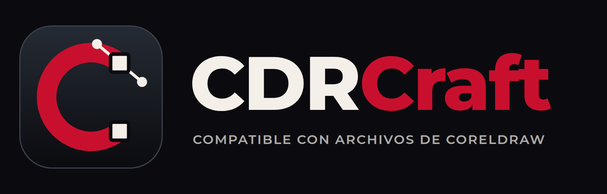

<p align="center">
  
</p>

# CDRCraft

Editor vectorial libre, compatible con archivos de CorelDRAW (`.cdr`), para Linux, Windows y macOS.

CDRCraft se basa en [TraceDraw](https://github.com/tracedraw/tracedraw), un editor vectorial de código abierto escrito en Rust, y le suma:

- Interfaz en español por defecto (y 18 idiomas más), con el nombre y el logo de CDRCraft.
- Guardado en `.cdr` versión 26 por defecto, la que abre CorelDRAW 2025.
- Paleta de colores "Budapest" incluida.
- Informes de fallos automáticos con permiso del usuario (ver [Privacidad](#privacidad)).
- Sin búsqueda de actualizaciones de TraceDraw (no reemplaza a CDRCraft).

Todo lo demás viene de TraceDraw: páginas y capas, curvas y nodos, texto artístico y de párrafo, rellenos, contornos, transparencias, sombras, PowerClip, mezclas, contornos, envolturas, extrusiones, lentes, símbolos, PDF/X, y lectura de `.cdr` de las versiones 1 a 27 (escritura 7 a 27), además de SVG, PDF, AI, EPS, DXF, PSD, EMF, WMF y más. El estado de cada función está en [docs/features.md](docs/features.md).

> Estado: alfa, como TraceDraw. Guardá copias de los archivos importantes.

## Instalar desde el código

Hace falta Rust 1.89 o más nuevo.

```bash
cargo build --release -p tracedraw -p tracedraw-cli
```

El programa queda en `target/release/tracedraw` y la herramienta de línea de comandos en `target/release/tracedraw-cli`. En Linux, `packaging/linux/cdrcraft.desktop` es el lanzador (ícono en `assets/icon`).

Variables al compilar:

| Variable | Para qué |
|---|---|
| `CDRCRAFT_CRASH_DSN` | Dirección del servicio de informes de fallos (Sentry o GlitchTip). Sin ella no se envía nada. |
| `CDRCRAFT_REPO` | Dirección del repositorio, para los enlaces de "Informar un problema". |

## Línea de comandos

```bash
tracedraw-cli info dibujo.cdr
tracedraw-cli convert dibujo.cdr dibujo.pdf
tracedraw-cli convert dibujo.svg dibujo.cdr      # guarda versión 26
TRACEDRAW_CDR_VERSION=27 tracedraw-cli convert a.cdr b.cdr
```

## Privacidad

CDRCraft no tiene cuentas, publicidad ni analítica. Si el programa se cierra por un error, la siguiente vez que se abre pregunta una sola vez si puede enviar informes de fallos automáticamente. El informe lleva el error, la versión, el sistema y el registro del programa, con la carpeta personal y el nombre de usuario ocultos; nunca los dibujos. La respuesta queda en el archivo de ajustes (`crash_reports`) y se puede cambiar allí. Detalle en [PRIVACY.md](PRIVACY.md).

## Traer mejoras de TraceDraw

```bash
git remote add upstream https://github.com/tracedraw/tracedraw.git   # una sola vez
git fetch upstream
git merge upstream/main
```

Los cambios propios de CDRCraft están descritos en [CDRCRAFT.md](CDRCRAFT.md).

## Licencia y créditos

Doble licencia MIT o Apache-2.0, igual que TraceDraw ([LICENSE-MIT](LICENSE-MIT), [LICENSE-APACHE](LICENSE-APACHE)). Los avisos de autoría de TraceDraw se conservan en [CONTRIBUTORS.md](CONTRIBUTORS.md) y [ATTRIBUTION.md](ATTRIBUTION.md); su README original está en [README-TraceDraw.md](README-TraceDraw.md).

CDRCraft y TraceDraw son proyectos independientes, sin relación con Corel Corporation ni Alludo. CorelDRAW es una marca registrada de Corel Corporation. La compatibilidad con `.cdr` se implementó de forma independiente, por interoperabilidad.
